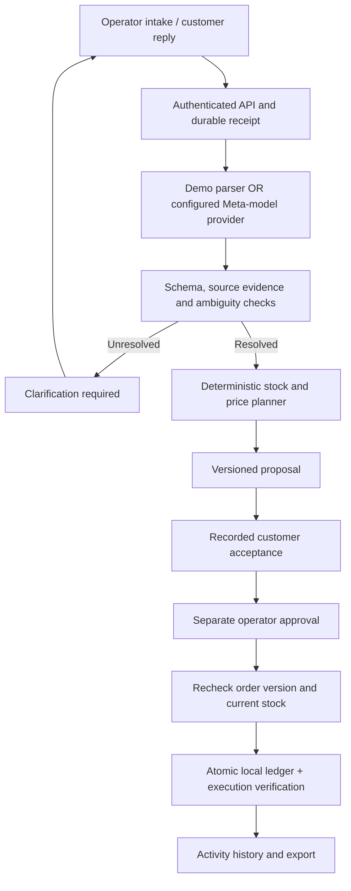
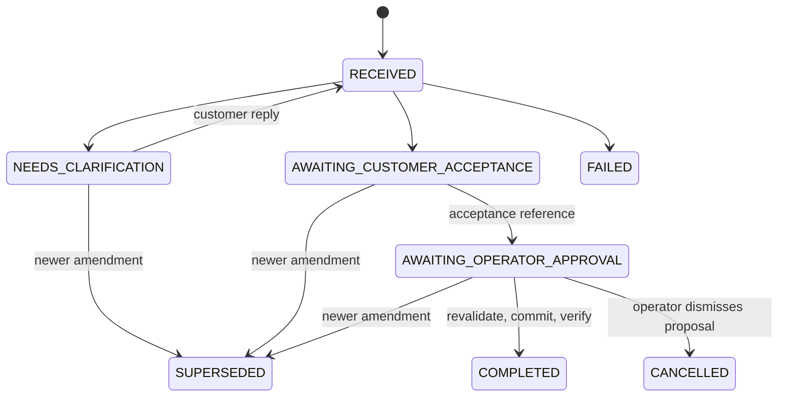

# Relay — evidence-backed order exception operations

Relay helps a distributor resolve changed customer orders without losing track of stock, agreed prices, or acceptance. Meta models interpret requests; ordinary code checks inventory; an operator records customer acceptance and separately approves a versioned proposal.

## Working release

- Order-linked message intake persisted **before** inference.
- Explicit demo parsing, Meta Responses API, Baseten Chat Completions, or Fireworks Chat Completions. No automatic provider fallback.
- Ambiguous boxes, relative dates, unknown requests, and detected operational-instruction text held for clarification.
- Customer clarification turns retained beside the original message.
- Full, partial, and catalog-substitution proposals; price preservation.
- Customer acceptance recorded separately, tied to an exact proposal version and option.
- New amendments supersede unfinished proposals and invalidate their acceptances.
- Operator approval revalidates stock and order version before an atomic local ledger commit.
- Cancellation releases reserved units only after acceptance and approval.
- Duplicate detection, activity history, execution verification, and JSON export.
- Owner-private hosted Site; separate durable workspace per authenticated user. Local SQLite preview.

This release updates its own ledger. It does not send WhatsApp messages or write to a real ERP. Customer acceptance is explicitly an **operator attestation**, not a verified WhatsApp callback. Merchant teams and production role permissions remain pilot work.

## Run

Node.js 24+ is required for built-in SQLite.

```sh
npm ci
npm run dev
```

Open http://127.0.0.1:4173. Persistent local records are in ignored `.local/relay.sqlite`. Restart the dev command after editing source. The local identity bypass exists only in the loopback development adapter.

```sh
npm test
node scripts/evaluate.mjs
npm run validate
```

The test suite covers stock, conflicting approvals, acceptance versions, supersession, cancellation, durable failure receipts, authentication, provider requests, and webhook adapter verification. `docs/evaluation.json` is a labeled **deterministic parser/policy** evaluation, not a model-accuracy benchmark.

## Live Meta inference and alternatives

Set environment variables in the server process, or configure them through Sites runtime settings for the hosted app. The dev server does not automatically read `.env` files. Keep keys out of source, browser code, and screenshots.

| Provider | META_PROVIDER | Secret | META_MODEL |
| --- | --- | --- | --- |
| Meta | meta (default) | MODEL_API_KEY | muse-spark-1.3 (default) |
| Baseten | baseten | BASETEN_API_KEY | Explicit eligible Meta model ID from the provider |
| Fireworks | fireworks | FIREWORKS_API_KEY | Explicit eligible Meta model/deployment ID from the provider |

For the hackathon, the participant guide specifically names `meta-models/muse-spark-open-1026` for Baseten; verify availability for your account. Fireworks deployments need their own confirmed model identifier. Keys and model IDs are never interchangeable between providers. All destinations are fixed in server code; no arbitrary inference URL is accepted.

Missing configuration and provider errors fail explicitly. Input and returned exact quotations are validated before planning. The interpreter records provider, model, response identifier, token counts when supplied, and latency with the analysis turn. These are audit metadata, not proof of model correctness. A six-scenario synthetic live evaluation passed with real Muse Spark calls. See docs/live-evaluation.json and docs/live-smoke.json. This small set is not statistical evidence of production accuracy. The owner’s $150 free-credit grant was confirmed; calls succeeded without adding a payment method.

## Architecture



| Layer | Source |
| --- | --- |
| Interface | public/ |
| Identity, bounds, orchestration | worker/index.js |
| Inference providers | src/meta.js |
| Deterministic rules | src/domain.js |
| Conversation and proposal state | src/workflow.js |
| Atomic persistence | src/storage.js, db/, drizzle/ |
| WhatsApp adapter library (not activated) | src/channels/whatsapp.js |



Intake and interpretation commit separately so provider failures cannot erase a received request. Every state write uses compare-and-swap against the workspace version. Concurrent saves reject one snapshot rather than partially updating inventory. There is no external ERP call inside this transaction. A real ERP must use idempotency keys and reconcile unknown outcomes before retrying; this release makes no end-to-end exactly-once guarantee.

## API contracts

- `GET /api/workspace`: state, proposals, drafts, provider configuration status.
- `POST /api/messages`: `{id, orderId, text, mode: "demo" | "meta"}`. Stable ID required on replay. Duplicates return the original case; conflicting reuse returns 409.
- `POST /api/clarifications`: `{caseId, id, text}`. Reply to a case awaiting clarification, using a fresh stable message ID. Repeated replies deduplicate.
- `POST /api/acceptances`: `{caseId, proposalVersion, choiceId, confirmed: true, reference}`. Records operator attestation; does not mutate the order.
- `POST /api/decisions`: `{caseId, action: "approve", proposalVersion, choiceId}`, or `{caseId, action: "dismiss"}`. Approval must match the accepted proposal.
- `GET /api/export`: workspace JSON including source messages and activity history.
- `POST /api/reset`: `{confirm: "RESET DEMO"}`. Explicitly resets synthetic data.

## Inventory and data semantics

Physical stock minus allocations gives availability. Editing an order excludes its own old allocation when calculating its replacement. Partial fulfillment preserves the full requested quantity and leaves the remainder outstanding. The displayed value at risk is estimated unallocated quantity multiplied by agreed price; it is not measured revenue recovered.

Each authenticated user has an independent bounded workspace. This is not yet a shared merchant tenant or a production multi-role system. Up to 500 source messages are retained per workspace. The JSON record keeps order, allocation, proposal, and activity changes atomic. The activity trail is not tamper-proof or compliance-grade logging. Resetting demo data clears it; export first if you need to retain it.

## WhatsApp adapter status

The adapter library verifies HMAC-SHA256 over the original raw body, checks subscription challenges, normalizes text messages using an explicit phone-to-merchant map, and reports unsupported media. Tests use signed synthetic payloads.

**There is no live webhook endpoint enabled.** The hosted Site is owner-private. Real integration needs an appropriate independently authenticated public ingress, merchant/customer/order mapping, durable delivery processing, a configured WhatsApp test number and app secret, an outbound messaging policy, and real delivery testing. Do not make the app public or disable its authentication just to receive webhooks. Audio is explicitly unsupported in the current adapter.

## Deployment and rollback

`npm run build` bundles the Worker and embeds the interface. Sites provisions the `DB` binding and applies committed Drizzle migrations. Use the existing Sites project identity and source workflow helper to synchronize, package, and privately deploy. Never replace the manifest with a public export when deploying the owner workspace.

The upgraded JSON state is additive; no existing database migration is rewritten. Older cases are projected into workflow states when read. Rollback to the previous version is an emergency operation: old code does not enforce separate acceptance or recognize every new state, so do not execute pending proposals after rollback without review. Export data and pause writes before a rollback.

## Public source and submission

`node scripts/export-public.mjs` creates a sanitized source checkout under ignored `.local/public-source`, removing the owner-specific Site ID and custom-domain setup details. It never copies local databases, environment files, credentials, or build output.

Relay has been submitted to the Meta Global AI Developer Hackathon. [Watch the three-minute demo](https://github.com/gowtham66867/relay-order-operations/releases/tag/demo-v1). See `docs/submission-readiness.md` for the submission record and actual live Meta evaluation evidence, and `docs/cloud-run.md` for the private Cloud Run deployment. Merchant savings require pilot measurement.

References: [Meta quickstart](https://dev.meta.ai/docs/quickstart), [participant guide](https://cerebralvalley.ai/e/meta-ai-developer-hackathon/details), [Baseten API](https://docs.baseten.co/reference/inference-api/chat-completions), [Fireworks API](https://docs.fireworks.ai/api-reference/post-chatcompletions), [Meta webhook sample](https://github.com/fbsamples/whatsapp-api-examples/tree/main/signature-validation-with-webhooks-payloads).
